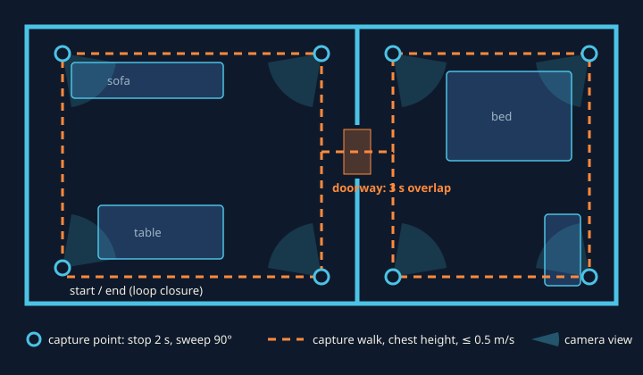

# Wayfarer Capture SOP

How to film an indoor space with an ordinary smartphone so the pipeline produces a sharp, metric, walkable digital twin. Every rule exists because of a specific failure mode in reconstruction; the reason is given next to it.

## 0. Kit

| Item | Why |
|---|---|
| Any phone with a 1080p+ main camera | The 1x lens has the least distortion and the best low-light SNR |
| Measuring tape | One measurement (ceiling height) fixes metric scale |
| 10 minutes per ~50 m² | About 1 minute of footage per room |

## 1. Prepare the space (5 min)

1. **All lights on, curtains half-drawn.** Even light avoids blown-out windows and black corners; direct sun patches move during the capture.
2. **Ceiling fans and moving objects off/out.** Structure-from-Motion assumes a static scene; a spinning fan creates floaters.
3. **Open every interior door fully.** Doorways are how separate rooms are stitched into one model.
4. **Screens off, big mirrors covered or avoided.** Mirrors and screens show a "fake room" that the reconstruction will try to place behind the wall.
5. **Measure floor-to-ceiling height** in one room with the tape and note it (e.g. `2.75`). This becomes `--ceiling 2.75` and gives centimetre-level metric scale.

## 2. Phone settings

| Setting | Value | Why |
|---|---|---|
| Lens | **1x main** (not 0.5x ultra-wide) | Ultra-wide distortion and softness hurt feature matching |
| Resolution | 4K/30 (or 1080p/60) | More pixels = more features; the pipeline downsizes to 1600 px anyway |
| Orientation | **Landscape** | Wider horizontal field of view = more overlap between frames |
| Focus / exposure | **Lock (AE/AF lock)** | Brightness pumping between frames breaks the photometric consistency splatting relies on |
| Stabilisation | On | Reduces motion blur; the pipeline also rejects blurry frames |
| HDR / beauty / night mode | Off | Per-frame tone mapping changes colours frame to frame |

## 3. Capture path

For **each room**:

1. **Perimeter loop, facing in.** Walk slowly around the room about 0.5–1 m from the walls with the camera pointed toward the room centre, held at **chest height (~1.4 m)**. This covers every surface from many angles.
2. **Corner sweeps.** At every corner (capture point), stop for 2 s and slowly sweep 90° so both adjoining walls stay in view.
3. **Tilt slightly down (10–15°)** most of the time. The floor must be visible: the pipeline detects the floor plane to level the model and to decide where you can walk.
4. **One slow ceiling sweep per room.** Point up for ~3 s. The ceiling plane plus your tape measurement gives the metric scale.
5. **Low pass around big furniture (optional).** One loop at ~0.8 m around beds/tables fills in the gaps under and around them.

**Between rooms:** walk *through* the doorway slowly, camera pointing forward, keeping both rooms in view for ~3 s. These frames tie the two rooms together.

**Finish where you started** (loop closure). Seeing the start again lets COLMAP correct drift.

### Motion rules

- Walk at **≤ 0.5 m/s** and turn at **≤ 30°/s**. Fast pans are the #1 cause of failed reconstructions.
- **Never film a blank wall from closer than ~1 m.** Blank surfaces have no features; keep some furniture, an edge or a corner in frame.
- Keep the phone at a steady height. The pipeline cross-checks scale against an assumed 1.4 m camera height.

## 4. One take or room by room

| Mode | When | Command |
|---|---|---|
| **One long video** | Homes and small offices, up to ~8 min | `python pipeline/wayfarer.py walk.mp4 --name home --ceiling 2.75` |
| **Room by room** | Large venues, or when a take goes wrong | `python pipeline/wayfarer.py room1.mp4 room2.mp4 hall.mp4 --name venue --ceiling 3.1` |

In room-by-room mode, **every clip must start and end in a doorway, overlapping its neighbour**. The pipeline then switches COLMAP to exhaustive matching, so the clips register into one model without manual alignment.

## 5. Quality gates (checked automatically, printed by the pipeline)

| Gate | Pass | If it fails |
|---|---|---|
| Sharp frames kept | > 70 % of sampled frames | Re-shoot slower, with more light |
| COLMAP registered frames | > 90 % of kept frames | Add doorway overlap, avoid blank walls |
| **Scale cross-check**: ceiling estimate vs camera-height estimate | Within ~5 % | Re-measure the ceiling, or pass `--scale` |
| Walkable area | Roughly matches the real floor area | Re-shoot low-coverage rooms with more floor in view |

## 6. Privacy

Remove or cover personal documents, photos and screens before filming. The twin is photorealistic and readable.
